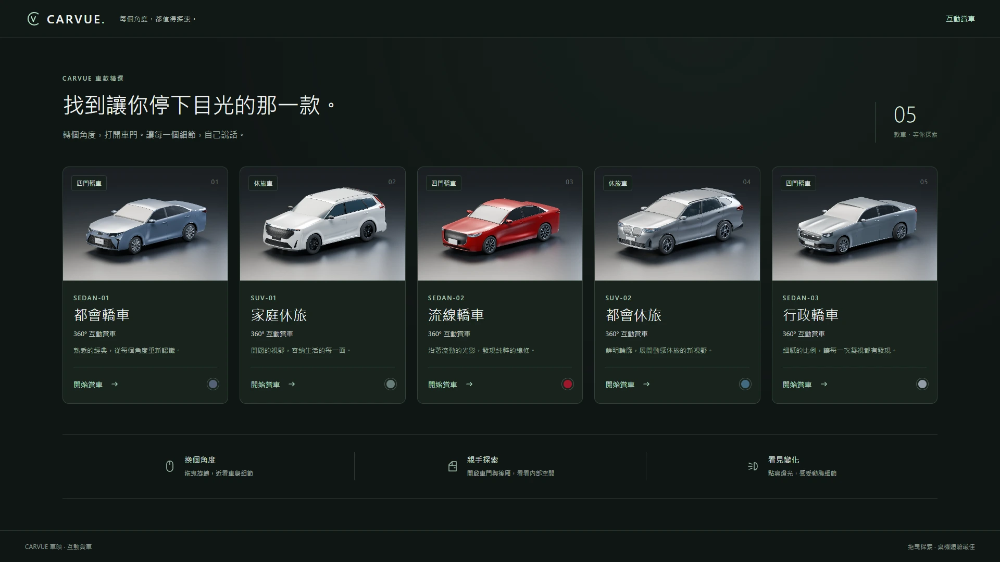
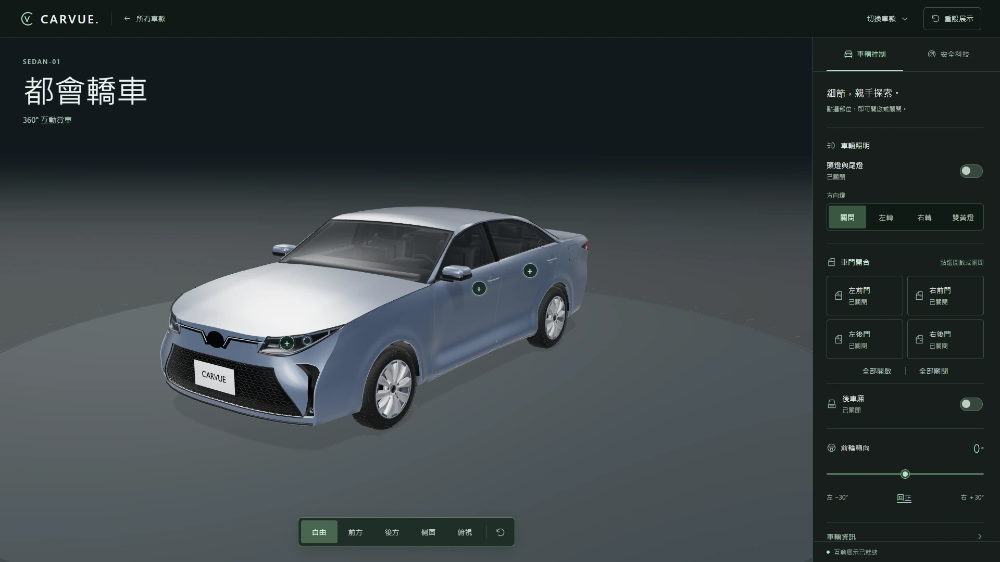
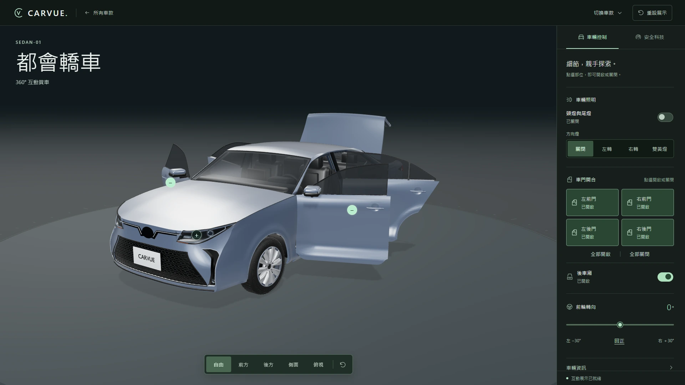
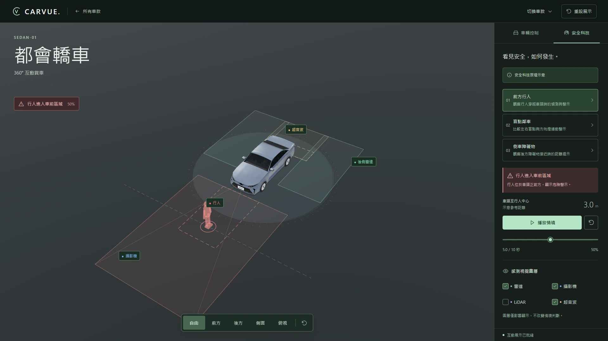

# CARVUE 車映

**轉個角度，探索車輛的每一面。**

[線上體驗](https://tsuniwan.github.io/carvue/#/vehicles) · [開發文件](docs/product-plan.md) · [CI](https://github.com/TsuNiWan/carvue/actions/workflows/ci.yml)

CARVUE 是以 Vue 與 Three.js 打造的網頁版 3D 賞車網站。從五款轎車與休旅車中選擇喜歡的車款，自由轉動視角、探索車身細節，並操作車門、燈光與轉向。



## 功能

- **360° 賞車**：滑鼠拖曳旋轉、滾輪縮放，快速切換前方、後方、側面與俯視角度。
- **車門與後廂**：獨立控制四門與後廂／尾門，透過連續開合動畫查看內部空間。
- **燈光與轉向**：切換頭尾燈、左右方向燈與雙黃燈，調整前輪轉向角度。
- **直覺操作**：點選車上熱點或使用控制面板，也支援鍵盤操作與一鍵重設。
- **安全科技展示**：探索三種情境，觀察感測範圍與播放過程。

## 畫面預覽

| 單車展示 | 車門與後廂開啟 |
| --- | --- |
|  |  |



完整互動體驗適用桌機 Chrome／Edge；手機提供車款介紹與預覽。

## 快速開始

需要 **Node.js 24 以上**與 npm。

```sh
git clone https://github.com/TsuNiWan/carvue.git
cd carvue
npm ci
npm run dev
```

開啟 `http://127.0.0.1:5173/#/vehicles`。

| 操作 | 方法 |
| --- | --- |
| 旋轉／縮放 | 拖曳／滾輪；聚焦畫布後使用方向鍵／加減鍵 |
| 開關車門與燈光 | 車上熱點或右側控制面板 |
| 重設視角 | 視角列或 Home 鍵 |
| 還原展示狀態 | 頂端「重設展示」 |
| 查看安全科技 | 右側「安全科技」分頁 |

建置與預覽：

```sh
npm run build
npm run preview
```

網站輸出至 `dist/`，可部署至靜態主機。專案已包含 GitHub Actions 與 GitHub Pages 部署流程。

## 技術

- **介面**：Vue 3、Vue Router、TypeScript、Vite。
- **3D**：Three.js、GLTFLoader、Meshopt、three-mesh-bvh。
- **模型製作**：Blender，可編輯來源與匯出腳本隨專案提供。
- **測試**：Vitest、Playwright。

車款與素材以版本化檔案維護，不需要後端或資料庫。

## 開發文件

[產品架構與規格](docs/product-plan.md) · [UI／UX 設計](docs/design.md) · [模型維護](docs/vehicle-assets.md) · [測試與部署](docs/verification.md)

## 授權

程式與文字文件採 [MIT](LICENSE)。車輛模型及相關視覺素材的權利範圍另見 [素材權利](ASSET_RIGHTS.md)；相依套件聲明見 [第三方授權](THIRD_PARTY_NOTICES.md)。
